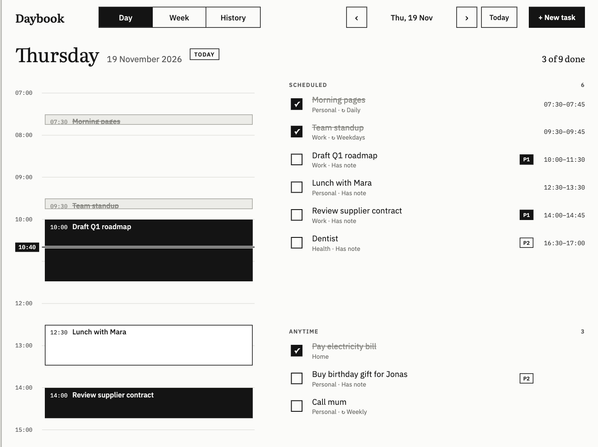
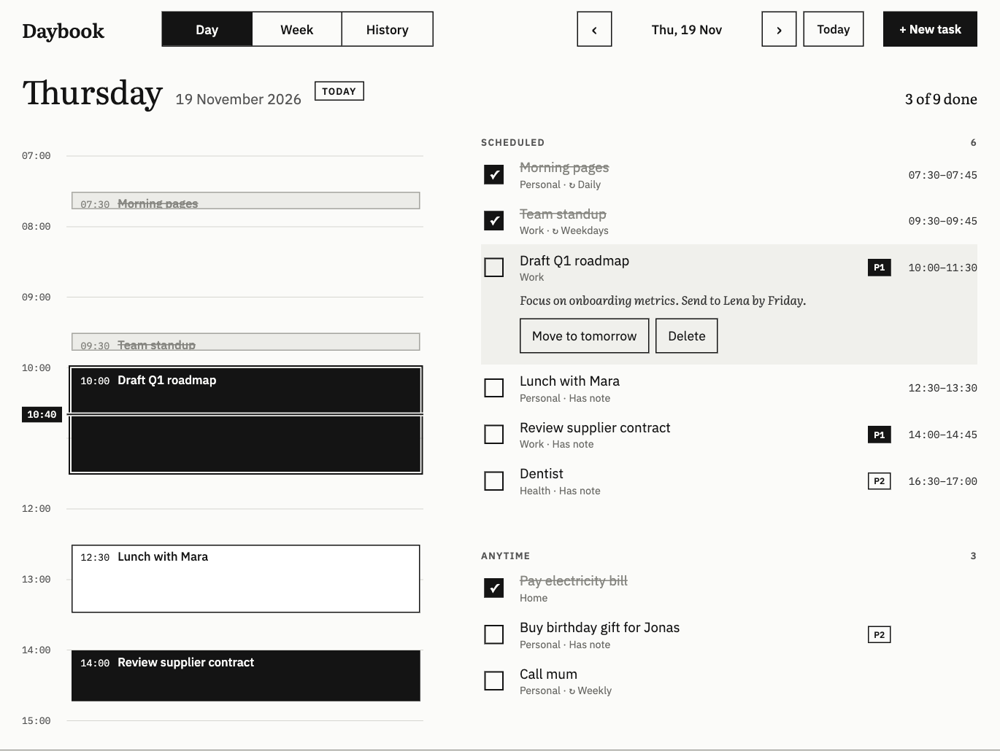
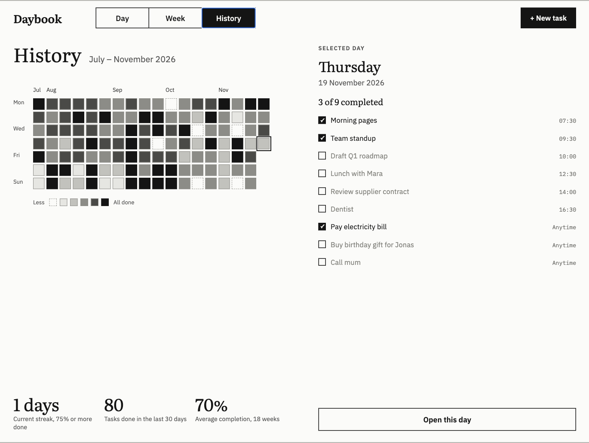
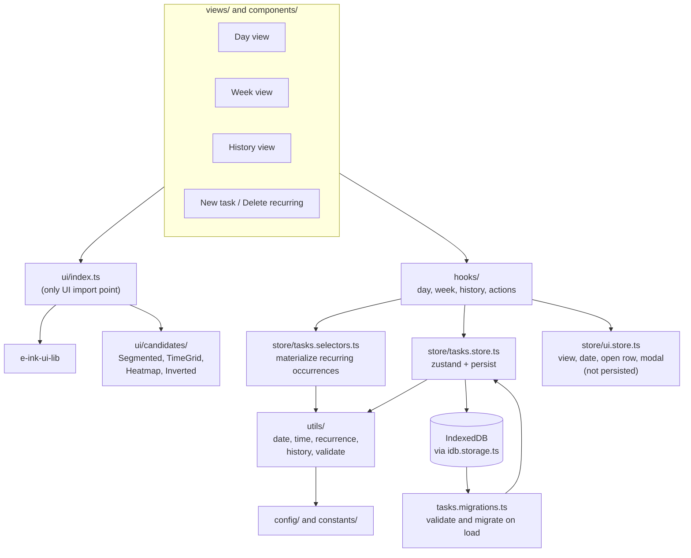

# Daybook

**A calm, private day planner for e-ink tablets.**

Daybook is a landscape-only, standalone-only Progressive Web App for planning your day, your week and looking back at your habits. It is built for the constraints of e-ink screens: high contrast, no animations, no colour, large touch targets.

Everything stays on your device. Tasks live in IndexedDB, the app makes **no network requests** after it is installed, and there is no account, analytics or telemetry.

## Features

- **Day view**: hour timeline with a live "now" marker, scheduled and "Anytime" lists, expandable rows with notes, move-to-tomorrow and delete.
- **Week view**: Monday to Sunday columns with per-day progress, today highlighted, tap a day to open it.
- **History view**: 18-week completion heatmap, current streak, tasks done in the last 30 days, average completion and a drill-down into any day.
- **Recurring tasks**: daily, weekdays or weekly, with "only this day" or "this and all future days" deletion.
- **Carry-over**: offers to move yesterday's unfinished tasks to today.
- **Offline-first PWA**: installable, precached, with an update prompt.
- **Security by design**: strict CSP, validated persisted data, pinned dependencies and GitHub Actions, no third-party origins.

## Screenshots

| Day | Day with details |
|---|---|
|  |  |

| Week | History |
|---|---|
|  |  |

| New task |
|---|
|  |

## Getting started

Requires Node.js as pinned in `.nvmrc` (24.17.0 or newer).

```sh
git clone https://github.com/AlexisRoe/task-manager-eink.git
cd task-manager-eink
nvm use        # picks the Node version from .nvmrc
npm ci         # reproducible install from the lockfile
npm run dev    # http://localhost:5173
```

In development the standalone gate is bypassed and an empty store is filled with demo data (`src/dev/seed.fixture.ts`).

To try the installable production build:

```sh
npm run build
npm run preview
```

Then install the app from your browser and open it from the home screen; outside an installed window the production build only shows install instructions.

### Scripts

| Script | Purpose |
|---|---|
| `npm run dev` / `build` / `preview` | Dev server, production build, preview of the build |
| `npm test` / `test:watch` / `coverage` | Vitest (coverage thresholds enforced) |
| `npm run lint` / `lint:fix` / `format` | Biome |
| `npm run typecheck` | `tsc --noEmit` |
| `npm run security` | `npm audit` (high) + signature check |
| `npm run check` | lint + typecheck + coverage + build; run before finishing any change |

## Architecture



- **State:** tasks are persisted to IndexedDB; transient UI state is kept separately and never persisted.
- **Recurrence:** recurring tasks are stored as a series plus per-date occurrence state and materialized per day in the selectors; generated occurrences are never stored.
- **Dates:** local `YYYY-MM-DD` strings and `HH:MM` times handled by pure utilities, no date library.
- **UI:** components come only from `e-ink-ui-lib` through `src/ui/index.ts`. Missing components are built as candidates in `src/ui/candidates/` so they can be contributed upstream. App CSS is layout only.
- **PWA:** `vite-plugin-pwa` generates the service worker and manifest; `public/_headers` carries the CSP and security headers.

More background lives in `CONCEPT.md` (intent), `PLAN.md` (roadmap), `CLAUDE.md` (conventions) and `docs/decisions/` (ADRs).

## Security

See `SECURITY.md`. No third-party origins, strict CSP, validated persisted data, pinned dependencies and GitHub Actions pinned to commit SHAs.

## Deployment

Merging to `main` runs `.github/workflows/deploy.yml`: `npm run check`, then `wrangler deploy` (static assets from `dist/`, SPA fallback in `wrangler.jsonc`). It needs a `production` environment and a project-scoped `CLOUDFLARE_API_TOKEN` secret.

Set up branch protection on `main` yourself: require the `PR` checks (`check`, `dependency-review`, `secret-scan`) and `CodeQL`, require review, block force pushes.

## License

Released under the [MIT License](LICENSE). Copyright (c) 2026 Alexis Roehrling.
